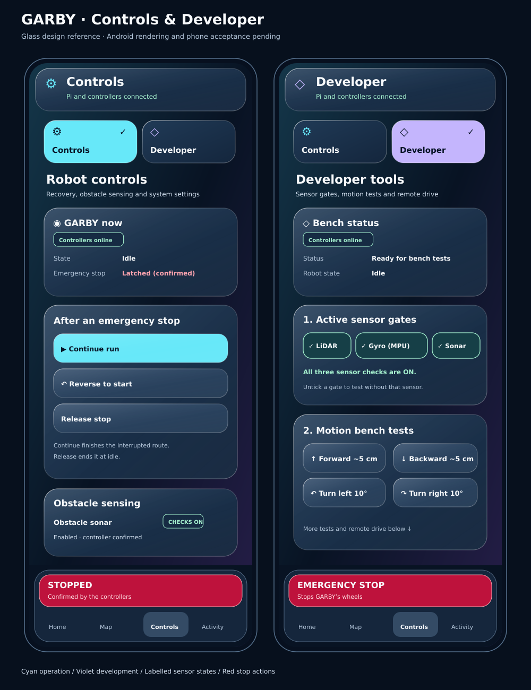

# Controls / Developer glass redesign — 2026-11-17

Changed `ControlsScreen.kt` and app-only usage/architecture/patch notes. The redesign is scoped
to these two sections: cyan Controls, violet Developer, navy glass fills, reflective rims,
opaque readable text, visible disabled controls with lock icons, explicit sensor state labels
and a responsive directional pad. The existing emergency stop bar remains separate.

Normal, Developer and 1.5× text previews are included in the same Kotlin file. The page uses
cached gradients instead of a backdrop bitmap or live blur. The conservative profile skips
shadows and scale animation; idle controls do not run decorative animation loops.

The image above is a native vector layout reference rendered locally for visual review. It
uses the implementation palette and hierarchy but does not establish actual Android screen
geometry, touch behavior or physical device acceptance.

| Check | Result |
| --- | --- |
| Existing app static checker | PASS |
| Action bindings, remote requests, sensor actions, confirmations, mask and existing gate | Retained; see `control-scope-check.log` |
| Kotlin delimiter review | Balanced; this is not compiler verification |
| Text/color pairs with the strongest white sheen | 4.65–13.22:1; see `contrast.json` |
| `git diff --check` | PASS |
| Windows local.properties, settings and Gradle properties | Identical hashes |
| Kotlin compile/lint | Could not start: uncached Gradle download denied with SocketException |
| Android preview/phone rendering and interaction | Not exercised here |

No tests were added for this reversible presentation change. There are no changes to
`OperatorViewModel.kt`, `OperatorDb.kt`, `OperatorModels.kt`, Pi or MCU source.
**MCU upload: None. Pi deployment: None for this redesign.** The earlier ARRIVAL-20261117
Executor/Pi requirement remains separate; installed versions are unknown. No upload,
deployment, robot command or live database action was performed.

The app directory and Windows SDK/build paths were preserved. Exact edited files/hashes:
[changes.json](changes.json). Commands, results and skips: [checks.json](checks.json).
