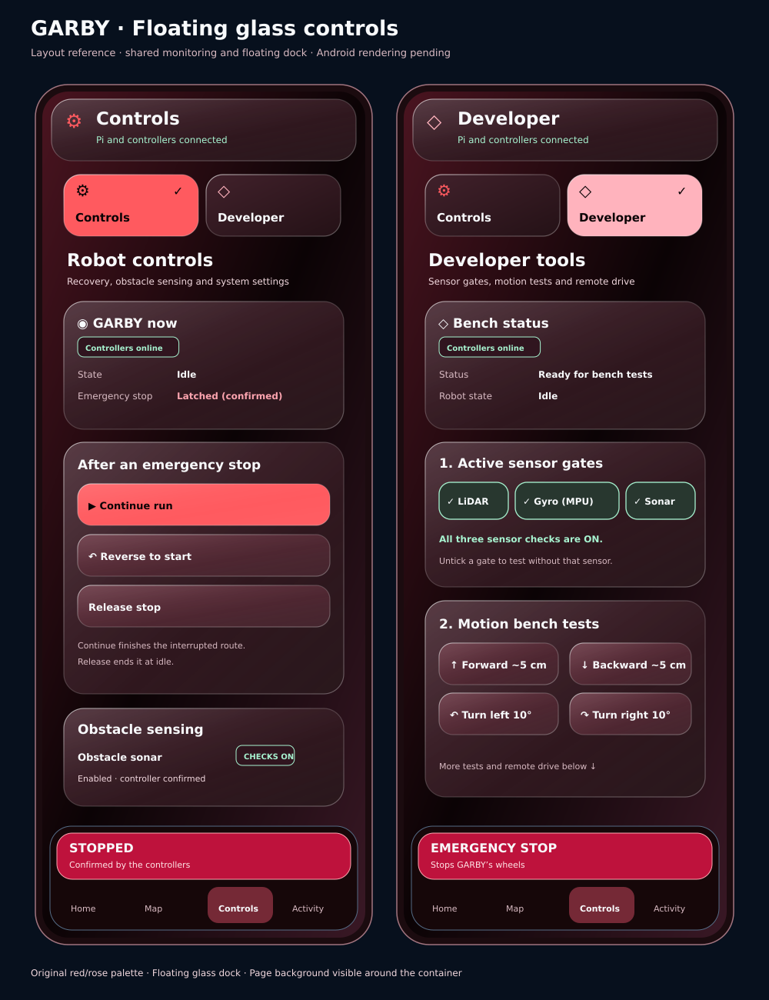

# App-wide monitoring / floating dock / original palette — 2026-11-17

The scope is Android only. The implementation applies to every device; no phone-brand or
model branches were added. The Windows directory, SDK and build-output settings are unchanged.

| Area | Before | Implemented |
| --- | --- | --- |
| Clock producers | Operator 1 s + return 1 s + dashboard 5 s | One shared background clock; consumers retain 1 s / 5 s age checks |
| Auth/network monitoring | Queried each second by the operator UI ticker | Event callbacks; command-time checks retained |
| Navigation observation | Full operator state, clock and map data | Distinct stop state in the small dock only |
| Background return sharing | Five-second linger per state/summary layer | Stops immediately when unobserved; live-state replay resets |
| Dock layout | Separate bottom area with a solid strip | Overlay on the page; transparent exterior and measured content inset |
| Controls palette | Cyan/violet redesign | Original GARBY red/rose with the clearer glass layout |

Map lease and ten-second map sleep remain unchanged. Status/command callbacks are not sampled
or delayed. Stop dominance, command IDs, freshness windows and return outcomes keep their rules.
The existing low-capacity profile still avoids heavy effects; the dock now also skips color
transitions on that profile. No extra worker pool, live blur or shader was introduced.



This is a vector layout reference for visual review. It is not phone rendering or evidence of
frame-time improvement.

| Check | Result |
| --- | --- |
| Existing + extended static quality checks | PASS |
| Old global polling/navigation/opaque-strip source rejected by checker | PASS; `negative-source-check.log` |
| Command gates, action bindings, confirmations and source delimiters | Preserved/balanced; `scope-checks.log` |
| Red/rose foreground contrast with maximum glass reflection | At least 4.5:1 for checked pairs; `contrast.json` |
| `git diff --check` and Windows configuration comparison | PASS |
| `:app:compileDebugKotlin :app:testDebugUnitTest :app:lintDebug` | Could not start: Gradle uncached; socket access denied |
| Android layout, frame timing, phone interaction | Not measured here |

New JVM cases cover three observers sharing one clock, immediate producer cancellation after
all leave, fresh clock restart, sixty map/clock updates yielding one unchanged dock state,
Pi status expiry, confirmed stop/offline updates and a pending-stop timeout without a database
callback. These tests exercise the production flow helpers but were not executed here.

Run from the existing Windows project folder:

```bat
python tools/static_quality_check.py
gradlew.bat :app:compileDebugKotlin :app:testDebugUnitTest :app:lintDebug
```

The earlier dated phone performance report remains historical and is not reused as acceptance
of this change. A fresh release-build frame trace is needed to quantify the improvement.

**MCU upload: None. Pi deployment: None for this change.** Earlier ARRIVAL-20261117 Executor/Pi
requirements remain separate; installed versions are unknown. No upload, restart, robot command,
APK publication or live database mutation was performed.

Exact edited/created files and hashes: [changes.json](changes.json). Exact checks/skips:
[checks.json](checks.json). Review patch: [changes.patch](changes.patch).
